# Parallel Prediction Model Based on TCN-SENet +BiGRU-GlobalAttention

Environment: Python 3.9, PyTorch 1.8 and above are all acceptable.
Model innovation point: Students who need to complete their graduation projects or write a small paper must pay attention to this, with rich modules and high innovation degree, superior performance!
Innovation points:
1. Utilize a series of time-convolutional layers in the Time-Convolutional Network (TCN), which can effectively capture sequence patterns at different temporal scales. Apply the SENet module on the output of TCN to learn and enhance the representation of important features, improving the model's ability to perceive key information;
2. Through the Bidirectional Gated Recurrent Unit (BiGRU) simultaneously modeling sequences from both forward and backward directions, better capturing dependencies within the sequence, while applying the Global Attention mechanism to weight the output of the BiGRU, allowing the model to focus on the most important parts of the sequence, enhancing prediction performance;
3. This innovative model has the capability to capture sequence information at different temporal scales and to weight different parts of the sequence, demonstrating high-precision predictive performance across multiple datasets!
50 epochs, training error is extremely small,
Multiple variable feature sequences TCN-SENet + BiGRU-GlobalAttention parallel integrated network model
Prediction effect is significant, the model can fully extract spatial and temporal features of time series, converges quickly, excellent performance, high prediction accuracy, can extract important features for model prediction from the spatiotemporal features of the sequence, the effect is obvious! Innovation also!!!
Environment: Python 3.9, PyTorch 1.8 and above are all acceptable.
Note: This product also comes with accompanying models explanation (for learning network structure) and parameter adjustment explanation! Students who need to complete their graduation projects or write a small paper must pay attention to this, with rich modules and high innovation degree, superior performance!!
At the same time, the code is accompanied by exquisite drawings and visualization of the feature importance of deep learning prediction models!
\tModel Training Visualization:
\t  
Multi-feature Contribution Visualization Analysis Diagram:
\t  
Preface
This article, based on the preliminary introduction of the power transformer (data set attached at the end), introduces a parallel prediction model based on TCN-SENet + BiGRU-GlobalAttention to enhance the predictive performance of time series data. For more detailed information about the power transformer dataset, please refer to the following text:
Introduction to the Power Transformer Dataset and Preprocessing
1. Overall Structure of the Model
The overall structure of the model is as follows:
Branch 1: Through the TCN model network based on channel attention mechanism (SENet), adaptively adjusting the weights of channel features, the model can automatically learn the importance of different channels, and extract important spatial features related to the prediction target from multi-feature sequences.
Branch 2: The multi-feature sequence data is simultaneously processed through a BiGRU network optimized with GlobalAttention. GlobalAttention is a mechanism designed to enhance the model's focus on different parts of the input sequence. In the BiGRU model, the global attention mechanism helps the model better concentrate on the most relevant parts of the input sequence, thereby improving the model's performance and generalization capabilities. At each time step, the global attention mechanism calculates a weight vector indicating the model's focus on various parts of the input sequence. These weights are then applied to the feature representations output by the BiGRU, enhancing the model's ability to specifically focus on important temporal features by weighting all positional features.
Feature fusion: Then, the spatial features and global time-domain features extracted by two branches are fused through stacking. Enable the model to better integrate feature representations at different levels. Improve the model's performance and generalization capabilities.
Channel Attention Mechanism
1. Squeeze-and-Excitation Networks
2. Global Attention Mechanism
3. Data Preparation for Multi-Feature Variables
   3.1 Importing Data
   3.2 Creating the Dataset
   3.3 Dataset and Classification Labels
4. High Precision Prediction Model Based on TCN-SENet + BiGRU-GlobalAttention in Parallel
    4.1 Definition of the Network Model
        Notice: The input data shape is [64, 7, 7], batch_size=32, where 7 represents the sequence length (the sliding window takes values), and the dimension of 7 dimensions represents the dimensions of 7 variables.
    4.2 Setting Up Parameters and Training the Model
        50 epochs, with a very small training error,
        The multi-variable feature sequence TCN-SENet + BiGRU-GlobalAttention parallel integrated network model has a significant prediction effect,
        The model can fully extract the spatial and temporal features of time series, converge quickly, perform excellently, have high prediction accuracy, and can extract important features for model prediction from the sequence's spatiotemporal features, which is evident!
        Pay attention to adjust parameters:
           Increase the number of TCN layers and hidden layer dimensions, fine-tune learning rate;
          Adjust the number of BiGRU layers and the number of neurons per layer, increase more epochs (be cautious to prevent overfitting);
          Change the sliding window length (set an appropriate window length)
5. Model Evaluation and Visualization
    5.1 Results Visualization
    5.2 Model Evaluation
    5.3 Feature Visualization
Time series forecasting: Analysis and comparison of LSTM, ARIMA, Holt-Winters, SARIMA models
Wind speed prediction (I) Data introduction and preprocessing
Wind speed prediction (II) EMD-LSTM model based on PyTorch
Wind speed prediction (III) EMD-LSTM-Attention model
Wind speed prediction (IV) EMD-Transformer model based on PyTorch
Wind speed prediction (V) EMD-CNN-LSTM model based on PyTorch
Wind speed prediction (VI) EMD-CNN-GRU parallel model based on PyTorch
CEEMDAN + combined forecasting model (BiLSTM-Attention + ARIMA)
CEEMDAN + combined forecasting model (CNN-LSTM + ARIMA)
CEEMDAN + combined forecasting model (Transformer - BiLSTM + ARIMA)
CEEMDAN + combined forecasting model (CNN-Transformer + ARIMA)
Multi-feature variable sequence prediction (I) - CNN-LSTM wind speed prediction model
Multi-feature variable sequence prediction (II) - CNN-LSTM-Attention wind speed prediction model
Multi-feature variable sequence prediction (III) - CNN-Transformer wind speed prediction model
Multi-feature variable sequence prediction (IV) Transformer-BiLSTM wind speed prediction model
Multi-feature variable sequence prediction (V) CEEMDAN+CNN-LSTM wind speed prediction model
Multi-feature variable sequence prediction (VI) CEEMDAN+CNN-Transformer wind speed prediction model
Prediction model based on SSA-SSA optimized algorithm for CEEMDAN-BiLSTM-Attention
Based on the Optimized Algorithm of Sparrows (SSA) for CEEMDAN-Transformer-BiGRU Prediction Model
Superior Prediction Model: Secondary Decomposition-Combination Prediction
Multi-feature variable sequence prediction (Part 7): CEEMDAN+Transformer-BiLSTM Prediction Model
Multi-feature variable sequence prediction (Part 8): Prediction Model Based on Sparrow Optimized Algorithm's CEEMDAN-SSA-BiLSTM
Multi-feature variable sequence prediction (Part 11): Prediction Model Based on Pytorch's TCN-GRU
VMD + CEEMDAN: Secondary Decomposition, CNN-LSTM Prediction Model
VMD + CEEMDAN: Secondary Decomposition, CNN-Transformer Prediction Model
Prediction Model Based on Sparrow Optimized Algorithm's SSA - Complete Code Kit
Superior Combination Prediction Model!
End
2. Friends who like this can click to follow, give "Attention" to the article, share in WeChat groups or discuss in discussion groups.

## Images

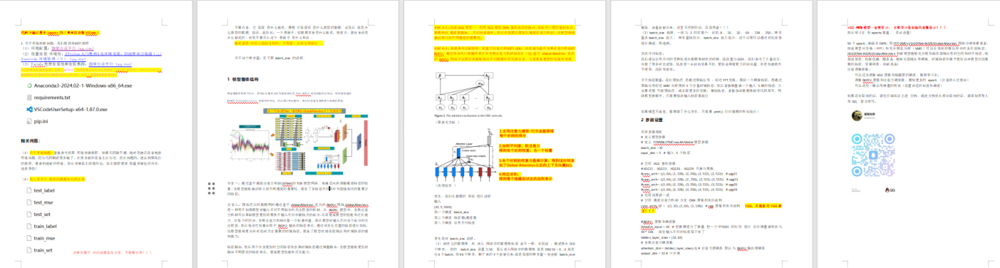
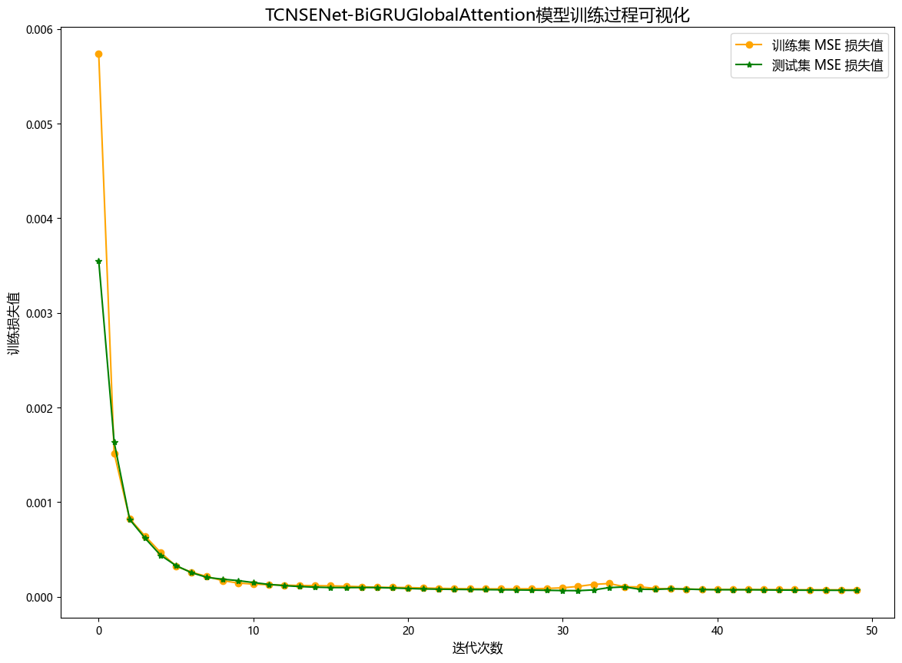
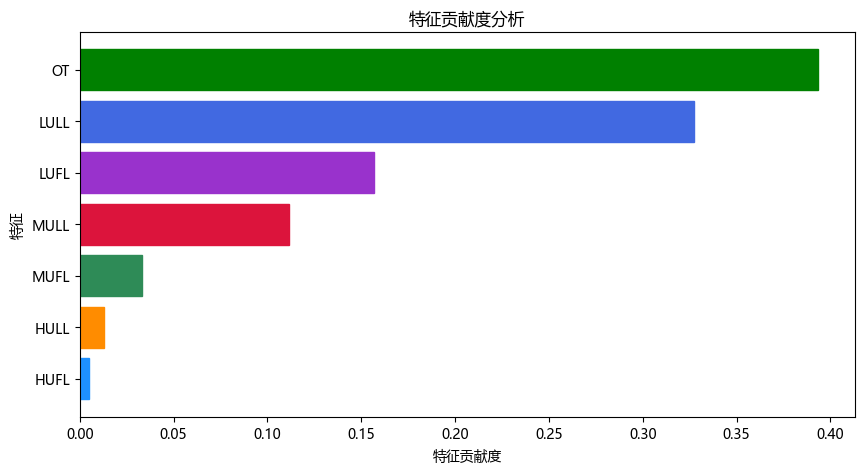
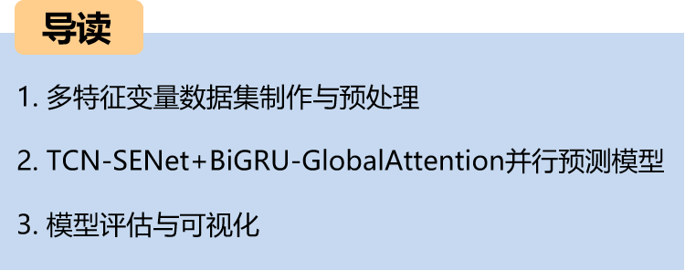
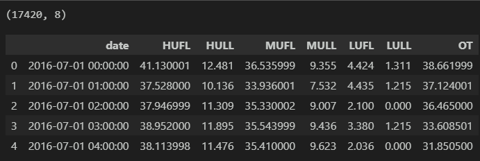
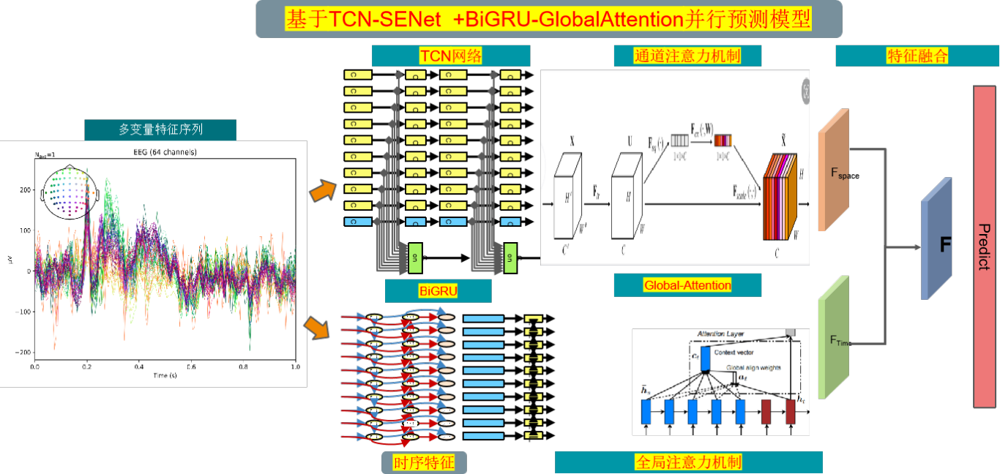

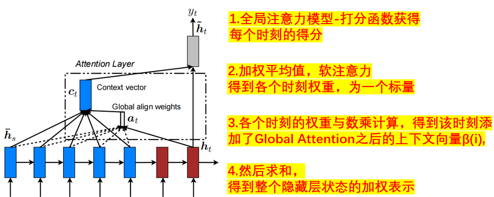

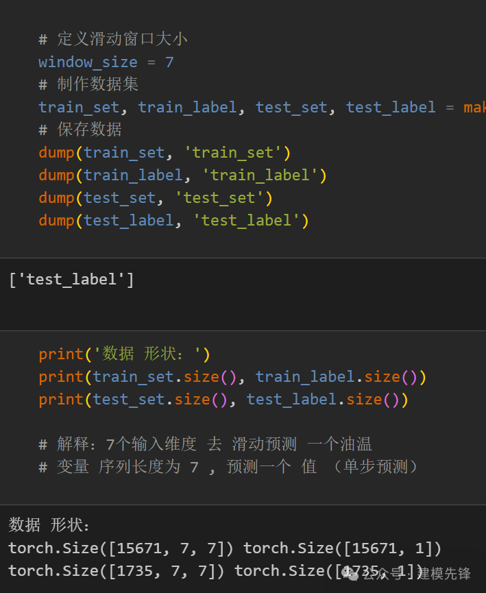
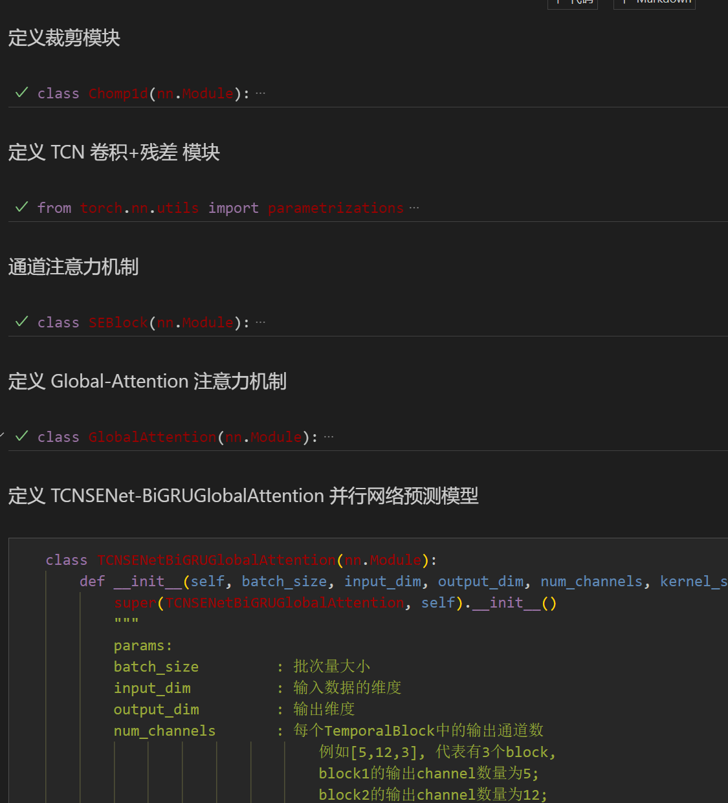
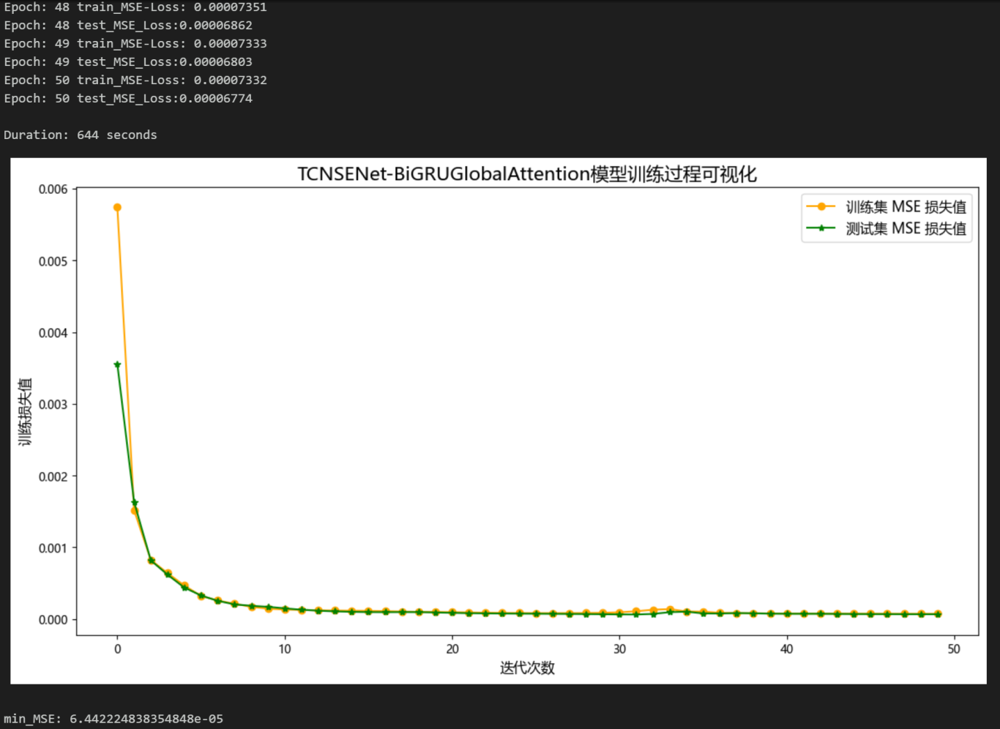
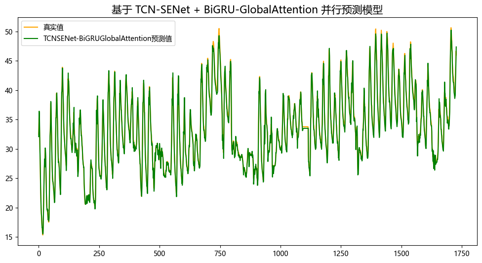
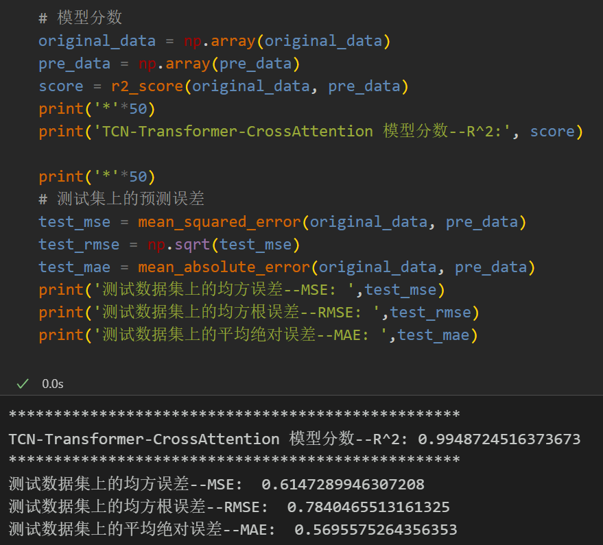
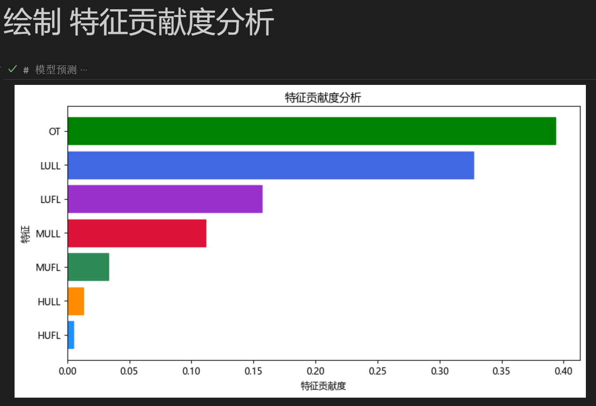
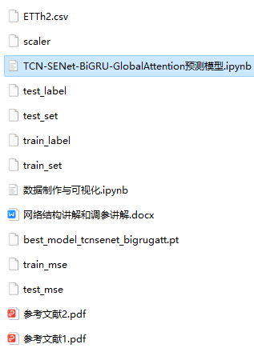

<!-- PAYMENT_BLOCK -->

## Get this dataset

- Payment link (Stripe): [Buy now](https://buy.stripe.com/3cs8yP7sY87d0vu9AB)
- Payment QR code: 

<!-- /PAYMENT_BLOCK -->
